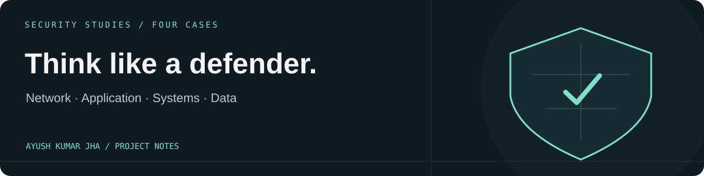

# Security Studies
### Four case studies in defensive security.

A collection of written coursework covering network defence, secure development, system hardening, and data protection. The deliverables are the reports below.

## Read the reports

| Report | Focus |
| --- | --- |
| [01 · Securing the perimeter](P1_Securing_the_perimeter.pdf) | Network exposure, segmentation, controlled access, VPNs, and monitoring |
| [02 · Security assessment](P2_Security_Assessment.pdf) | Secure development, application vulnerabilities, containers, and API controls |
| [03 · Compliance assessment](P3_Compliance_Assessment.pdf) | Endpoint hardening, security policies, and cloud access controls |
| [04 · Data security analysis](P4_Data_Security_Analysis.pdf) | Classification, access control, integrity, backup, and retention |

Open a PDF on GitHub to read it, or download it from the file page.

## What this repository demonstrates

The work connects technical observations to written findings and suggested controls. Its value is in the reasoning: what is exposed, what could go wrong, which control addresses it, and what still needs validation.

These are educational case studies, not an independent audit certification or evidence that the recommended controls have been deployed in production.

## Repository scope

This repository contains four PDF reports. There is no runnable application, hosted dashboard, or APK.

**Ayush Kumar Jha** · [Profile](https://github.com/AyushKJha) · [Portfolio](https://ayush-kumar-jha-v2.onrender.com/)
